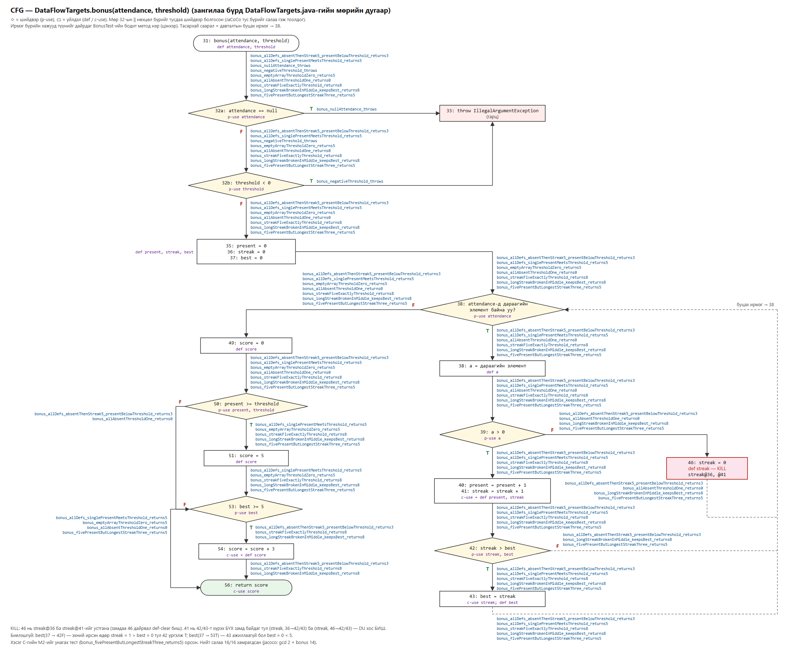

# Лаборатори №10 — Өгөгдлийн урсгалын тест: Definition-Use хосууд

**Оюутан:** Эрдэнэбаяр
**Оюутны код:** B232270136
**Хичээл:** F.CSA313 — Программ хангамжийн чанарын баталгаа ба тест (2026)

---

## 1. Ажлын орчин

```
$ java -version
openjdk version "17.0.20.1" 2026-08-18
OpenJDK Runtime Environment Temurin-17.0.20.1+1 (build 17.0.20.1+1)
OpenJDK 64-Bit Server VM Temurin-17.0.20.1+1 (build 17.0.20.1+1, mixed mode, sharing)

$ mvn -version
Apache Maven 3.9.9 (8e8579a9e76f7d015ee5ec7bfcdc97d260186937)
Maven home: C:\Users\THE_FEDzUP\tools\apache-maven-3.9.9
Java version: 17.0.20.1, vendor: Eclipse Adoptium, runtime: C:\Program Files\Eclipse Adoptium\jdk-17.0.20.101-hotspot
Default locale: en_US, platform encoding: Cp1252
OS name: "windows 11", version: "10.0", arch: "amd64", family: "windows"
```

| Зүйл | Утга |
|---|---|
| JDK | Eclipse Temurin OpenJDK 17.0.20.1 |
| Build | Apache Maven 3.9.9 |
| Тест / хамралт | JUnit Jupiter 5.10.2, surefire 3.2.5, JaCoCo 0.8.12 |
| ҮС | Windows 11 Pro (26200) |

> Starter-ийг (`lab10-dataflow/`: `pom.xml`, `.gitignore`, `DataFlowTargets.java`) өөрчлөлгүй
> хуулж эхний **"Starter"** commit болгосон. Анхны `mvn verify` → тест байхгүй, JaCoCo тайлан үүсээгүй.
>
> **Windows дээрх саад (Лаб 9-тэй ижил).** Хавтасны зам кирилл үсэгтэй тул JaCoCo agent-ийн
> зам тестийн JVM-ийн командад `????` болж эвдэрдэг. `pom.xml`-ийг өөрчлөлгүй, ижил хавтас руу
> заасан ASCII junction (`C:\THE_FEDzUP\lab10-dataflow`) үүсгэж `mvn`-ийг тэндээс ажиллуулсан.
> Гаралтыг `> results\<файл> 2>&1` гэж хадгалсан — Maven-ий гаралт ASCII тул UTF-8 текст.

**Мөрийн дугаар** бүгд `DataFlowTargets.java` ФАЙЛЫН мөр (лекцийн 1–8 → файлын 13–20:
1→13, 3→15, 4→16, 5→17, 6→18, 8→20).

---

## 2. Хэсэг A — gcd: бүрэн DU хүснэгт

```java
13  public static int gcd(int x, int y) {   // def x, def y (параметр)
14      int tmp;                            // зөвхөн зарлалт — утга онооогүй тул def БИШ
15      while (y != 0) {                    // p-use y
16          tmp = x % y;                    // c-use x, c-use y; def tmp
17          x = y;                          // c-use y; def x
18          y = tmp;                        // c-use tmp; def y
19      }
20      return x;                           // c-use x
```

p-use-ийг салаа тус бүрээр (15T → 16 руу, 15F → 20 руу) тусдаа хос гэж тоолсон.

| # | Хувьсагч | Def мөр | Use мөр | Төрөл | Def-clear зам | Тестийн ID | Хамрагдсан |
|---|---|---|---|---|---|---|---|
| 1 | x | 13 | 16 | c-use | 13 → 15T → 16 | G2, G3 | ✅ |
| 2 | x | 13 | 20 | c-use | 13 → 15F → 20 | **G1** | ✅ |
| 3 | x | 17 | 16 | c-use | 17 → 18 → 15T → 16 (2 дахь давталт) | **G3** | ✅ |
| 4 | x | 17 | 20 | c-use | 17 → 18 → 15F → 20 | G2, G3 | ✅ |
| 5 | y | 13 | 15T | p-use | 13 → 15T → 16 | G2, G3 | ✅ |
| 6 | y | 13 | 15F | p-use | 13 → 15F → 20 | **G1** | ✅ |
| 7 | y | 13 | 16 | c-use | 13 → 15T → 16 | G2, G3 | ✅ |
| 8 | y | 13 | 17 | c-use | 13 → 15T → 16 → 17 | G2, G3 | ✅ |
| 9 | y | 18 | 15T | p-use | 18 → 15T → 16 (2 дахь давталт) | **G3** | ✅ |
| 10 | y | 18 | 15F | p-use | 18 → 15F → 20 | G2, G3 | ✅ |
| 11 | y | 18 | 16 | c-use | 18 → 15T → 16 (2 дахь давталт) | **G3** | ✅ |
| 12 | y | 18 | 17 | c-use | 18 → 15T → 16 → 17 (2 дахь давталт) | **G3** | ✅ |
| 13 | tmp | 16 | 18 | c-use | 16 → 17 → 18 | G2, G3 | ✅ |

**Нийт 13 DU хос, 13/13 хамрагдсан, биелэшгүй хос байхгүй.**

- **Kill:** x-ийн 13-ын def-ийг 17 устгадаг. Тиймээс (x, 13, 20) хосын def-clear зам нь давталтыг
  нэг ч удаа гүйцэтгэхгүй байх (13 → 15F → 20) ганц зам. Мөн y-ийн 13-ын def-ийг 18 устгадаг.
- Мөр 14-ийн `int tmp;` нь def биш. Тиймээс "tmp-ийг def-гүйгээр уншдаг" хос байхгүй: tmp-ийн
  ганц use (18) үргэлж 16-ийн def-ийн араас ирдэг.
- Амархан мартагддаг хосууд нь **давталтын буцах ирмэг (18 → 15)-ийг шаарддаг 4 хос**:
  #3 (x, 17, 16), #9 (y, 18, 15T), #11 (y, 18, 16), #12 (y, 18, 17). Нэг давталттай тест тэдгээрийг хамардаггүй.

### Тестүүд — `src/test/java/mn/edu/must/sqat/GcdTest.java`

| ID | Тест (метод) | Оролт → гаралт | Давталт | Хамарсан хосууд (#) |
|---|---|---|---|---|
| G1 | `gcd_7_0_zeroIterations_returns7` | gcd(7, 0) = 7 | 0 | 2, 6 |
| G2 | `gcd_0_5_oneIteration_returns5` | gcd(0, 5) = 5 | 1 | 1, 4, 5, 7, 8, 10, 13 |
| G3 | `gcd_12_8_twoIterations_returns4` | gcd(12, 8) = 4 | 2 | 1, 3, 4, 5, 7–13 |

Тест бүрийн `@DisplayName`-д хамарч буй хосуудыг мөрийн дугаараар (латин үсгээр) бичсэн,
жишээ: `G1 gcd(7,0)=7 | x(13->20), y(13->15F)`.

- **gcd(7, 0) ганцаараа юуг хамардаг вэ?** y = 0 үед давталт огт ажиллахгүй. Энэ нь параметр
  x-ийн утга (def 13) өөрчлөгдөлгүйгээр `return x` (20)-д хүрэх ганц зам: **(x, 13, 20)**.
  y-ийн 15-ын F салааг анхны def-ээс нь хүргэх **(y, 13, 15F)** хос ч мөн зөвхөн энэ тестээр хамрагдана.
- **gcd(12, 8) хэдэн давталт хийдэг вэ?** 2 удаа: (12, 8) → (8, 4) → (4, 0). Хоёр дахь давталт
  руу орох буцах ирмэгээр def 17/18 нь 15, 16, 17-д хүрдэг. Тиймээс #3, #9, #11, #12 хосууд
  **2+ давталт шаарддаг** бөгөөд G3 л тэднийг хамарна. G2 (1 давталт) 13-аас 7 хосыг хамарна.
- 3 тест хамгийн бага хэрэгцээ биш: G1 + G3 хоёр л бүх 13 хосыг хамарна. G2-ийг 0/1/2+ давталтыг
  тус бүрд нь харуулахаар нэмсэн.

---

## 3. Хэсэг B — bonus: бүрэн анализ

### B1 — CFG (`cfg-bonus.png`)



- Зангилаа бүрд файлын мөрийн дугаар болон тэр мөр дэх def/use бичигдсэн.
- Мөр 32-ын `||` нөхцлийг **32a** (`attendance == null`) ба **32b** (`threshold < 0`) гэсэн хоёр
  тусдаа шийдвэр болгосон. JaCoCo нөхцөл бүрийг тусдаа салаа гэж тоолдог бөгөөд short-circuit-ийн улмаас
  32b зөвхөн 32a = F үед үнэлэгддэг.
- For-each давталтыг (мөр 38) хоёр зангилаагаар зурсан:
  - **38 ◇** — "attendance-д дараагийн элемент байна уу?" (attendance-ийн p-use);
  - **38 ▭** — "a = дараагийн элемент" (a-ийн def).
- 43, 42F, 46-аас гарах буцах ирмэгүүд (тасархай) 38 ◇ руу буцна.
- Ирмэг бүрийн хажууд түүнийг дайрдаг `BonusTest`-ийн **бодит метод нэр** бичигдсэн. Ингэхэд
  хамрагдаагүй ирмэг үлдээгүйг шууд харж болно.
- Зургийг SVG-ээр гараар байрлуулж зурсан. Тестийн нэрсийг `BonusTest.java`-аас хуулж, ирмэг бүрийн
  жагсаалтыг тест бүрийн оролтыг гараар мөрдөж гаргасан.

### B2 — Def/Use жагсаалт (мөр бүрээр)

```java
31  bonus(int[] attendance, int threshold)    // def attendance, def threshold
32  if (attendance == null || threshold < 0)  // p-use attendance (32a), p-use threshold (32b)
33      throw new IllegalArgumentException    // — (def/use байхгүй)
35  int present = 0;                          // def present
36  int streak = 0;                           // def streak
37  int best = 0;                             // def best
38  for (int a : attendance)                  // p-use attendance (дараагийн элемент байна уу?), def a (алхам)
39      if (a > 0)                            // p-use a
40          present = present + 1;            // c-use present, def present
41          streak = streak + 1;              // c-use streak,  def streak
42          if (streak > best)                // p-use streak, p-use best
43              best = streak;                // c-use streak,  def best
46      else streak = 0;                      // def streak  ← KILL (streak@36, streak@41)
49  int score = 0;                            // def score
50  if (present >= threshold)                 // p-use present, p-use threshold
51      score = 5;                            // def score    ← KILL (score@49)
53  if (best >= 5)                            // p-use best
54      score = score + 3;                    // c-use score, def score
56  return score;                             // c-use score
```

| Хувьсагч | Def мөр | c-use мөр | p-use мөр |
|---|---|---|---|
| attendance | 31 | — | 32a, 38 |
| threshold | 31 | — | 32b, 50 |
| present | 35, 40 | 40 | 50 |
| streak | 36, 41, 46 | 41, 43 | 42 |
| best | 37, 43 | — | 42, 53 |
| score | 49, 51, 54 | 54, 56 | — |
| a | 38 | — | 39 |

### B3 — DU хүснэгт

p-use-ийг салаа тус бүрээр (T/F) тусдаа мөр болгосон. Тестийн ID-г B4-ийн хүснэгтээс харна уу:
AD1–AD2 нь all-defs шат, DU1–DU6 нь all-DU-pairs шат.

| # | Хувьсагч | Def | Use | Төрөл | Def-clear зам (жишээ) | Тестийн ID | Хамрагдсан |
|---|---|---|---|---|---|---|---|
| 1 | attendance | 31 | 32a T | p | 31 → 32a(T) → 33 | DU1 | ✅ |
| 2 | attendance | 31 | 32a F | p | 31 → 32a(F) → 32b | AD1, AD2, DU2–DU6 | ✅ |
| 3 | attendance | 31 | 38 T | p | 31 → 32a F → 32b F → 35–37 → 38(T) | AD1, AD2, DU4–DU6 | ✅ |
| 4 | attendance | 31 | 38 F | p | … → 38(F) → 49 (attendance хэзээ ч дахин def болдоггүй) | AD1, AD2, DU3–DU6 | ✅ |
| 5 | threshold | 31 | 32b T | p | 31 → 32a F → 32b(T) → 33 | DU2 | ✅ |
| 6 | threshold | 31 | 32b F | p | 31 → 32a F → 32b(F) → 35 | AD1, AD2, DU3–DU6 | ✅ |
| 7 | threshold | 31 | 50 T | p | … → 38F → 49 → 50(T) | AD2, DU3, DU5, DU6 | ✅ |
| 8 | threshold | 31 | 50 F | p | … → 38F → 49 → 50(F) | AD1, DU4 | ✅ |
| 9 | present | 35 | 40 | c | 35 → 36 → 37 → 38T → 39T → 40 (эхний ирсэн өдөр) | AD1, AD2, DU5, DU6 | ✅ |
| 10 | present | 35 | 50 T | p | 35 → … → 38F → 49 → 50(T), 40 огт ажиллахгүй | **DU3** | ✅ |
| 11 | present | 35 | 50 F | p | 35 → (38T → 39F → 46)* → 38F → 49 → 50(F) | **DU4** | ✅ |
| 12 | present | 40 | 40 | c | 40 → 41 → 42 (→ 43) → 38T → 39T → 40 | AD1, DU5, DU6 | ✅ |
| 13 | present | 40 | 50 T | p | 40 → … → 38F → 49 → 50(T) | AD2, DU5, DU6 | ✅ |
| 14 | present | 40 | 50 F | p | 40 → … → 38F → 49 → 50(F) | AD1 | ✅ |
| 15 | streak | 36 | 41 | c | 36 → 37 → 38T → 39T → 40 → 41 (эхний элемент > 0, 46-г дайрахгүй) | AD1, AD2, DU5, DU6 | ✅ |
| 16 | streak | 41 | 41 | c | 41 → 42 (→ 43) → 38T → 39T → 40 → 41 (дараалсан ирц, 46-гүй) | AD1, DU5, DU6 | ✅ |
| 17 | streak | 41 | 42 T | p | 41 → 42(T) | AD1, AD2, DU5, DU6 | ✅ |
| 18 | streak | 41 | 42 F | p | 41 → 42(F) (цуваа өмнөх best-ээс урт биш) | AD1, DU6 | ✅ |
| 19 | streak | 41 | 43 | c | 41 → 42(T) → 43 | AD1, AD2, DU5, DU6 | ✅ |
| 20 | streak | 46 | 41 | c | 46 → 38T → 39T → 40 → 41 (тасалсны дараа ирсэн) | AD1, DU6 | ✅ |
| 21 | best | 37 | 42 T | p | 37 → 38T → 39T → 40 → 41 → 42(T) | AD1, AD2, DU5, DU6 | ✅ |
| 22 | best | 37 | 42 F | p | — | — | ⛔ биелэшгүй |
| 23 | best | 37 | 53 T | p | — | — | ⛔ биелэшгүй |
| 24 | best | 37 | 53 F | p | 37 → (38T → 39F → 46)* → 38F → 49 → 50 → 53(F) | DU3, DU4 | ✅ |
| 25 | best | 43 | 42 T | p | 43 → 38T → 39T → 40 → 41 → 42(T) | AD1, DU5, DU6 | ✅ |
| 26 | best | 43 | 42 F | p | 43 → 38T → 39F → 46 → 38T → 39T → 40 → 41 → 42(F) | AD1, DU6 | ✅ |
| 27 | best | 43 | 53 T | p | 43 → … → 38F → 49 → 50 → 53(T) | AD1, DU5, DU6 | ✅ |
| 28 | best | 43 | 53 F | p | 43 → … → 38F → 49 → 50 → 53(F) | AD2 | ✅ |
| 29 | score | 49 | 54 | c | 49 → 50(F) → 53(T) → 54 | **AD1** | ✅ |
| 30 | score | 49 | 56 | c | 49 → 50(F) → 53(F) → 56 | **DU4** | ✅ |
| 31 | score | 51 | 54 | c | 51 → 53(T) → 54 | **DU5**, DU6 | ✅ |
| 32 | score | 51 | 56 | c | 51 → 53(F) → 56 | AD2, DU3 | ✅ |
| 33 | score | 54 | 56 | c | 54 → 56 | AD1, DU5, DU6 | ✅ |
| 34 | a | 38 | 39 T | p | 38 → 39(T) | AD1, AD2, DU5, DU6 | ✅ |
| 35 | a | 38 | 39 F | p | 38 → 39(F) | AD1, DU4, DU6 | ✅ |

**Нийт 35 хос: 2 нь биелэшгүй, биелэх боломжтой 33 хосоос 33 нь хамрагдсан → all-DU-pairs хангагдсан.**

**Kill (мөр 46 `streak = 0`):** 46 нь streak@36 ба streak@41 гэсэн хоёр def-ийг устгадаг:
- 46-г дайрсан замаар (36, 41) ба (41, 41) хосууд def-clear биш. Тиймээс #15 нь эхний элемент > 0 байх,
  #16 нь дараалсан ирсэн өдрүүдтэй байх замыг шаарддаг. DU4 ([0, 0])-д streak@36 нь 46-д устгагдаж,
  ямар ч use-д хүрдэггүй.
- 46-ийн өөрийн def нь зөвхөн 41-д л хүрнэ (#20).
- 51 (`score = 5`) нь score@49-ийг устгадаг. Тиймээс #29, #30 зөвхөн 50F үед боломжтой.

**Def-clear замгүй тул DU хос БИШ:** (streak, 36 → 42), (streak, 36 → 43), (streak, 46 → 42),
(streak, 46 → 43). 42 ба 43 руу орох БҮХ зам 41-ийг (`streak = streak + 1`) дайрдаг тул 36/46-ийн
утга тэнд хүрэхээсээ өмнө устгагддаг. Мөн streak@41 болон streak@46-ийн утга давталтын дараа
хаана ч уншигддаггүй.

**Биелэшгүй хосуудын үндэслэл:**
- **#22 (best, 37, 42F):** 42-т анх хүрэх үед streak = 1 (36/46-аас 0 болоод 41 нэмсэн), best = 0 тул
  `1 > 0` үргэлж T. Тэгээд 43 шууд best-ийг дахин def болгох тул best@37-оор 42F руу орох зам байхгүй.
- **#23 (best, 37, 53T):** 37-оос 53 хүртэлх зам def-clear байхын тулд 43 нэг ч удаа ажиллах ёсгүй.
  Тэр үед best = 0 бөгөөд `0 >= 5` хэзээ ч T болохгүй.

### B4 (1-р шат) — ALL-DEFS: хамгийн цөөн тест = 2

| ID | Тест (метод) | Оролт → гаралт | Use-д хүргэсэн def-үүд |
|---|---|---|---|
| AD1 | `bonus_allDefs_absentThenStreak5_presentBelowThreshold_returns3` | bonus([1,0,1,1,1,1,1], 7) = 3 | attendance/threshold@31, present@35, @40, streak@36, @41, @46, best@37, @43, a@38, score@49 (→54), score@54 (→56) |
| AD2 | `bonus_allDefs_singlePresentMeetsThreshold_returns5` | bonus([1], 1) = 5 | score@51 (→56) |

**Яагаад 1 тест хангалтгүй вэ?** `score`-ийн гурван def-ийн 49 ба 51 хоёрыг нэг гүйцэтгэлд
use-д хүргэх боломжгүй. 49 → 50 → 51 замд `score`-ийг уншдаг мөр байхгүй тул 51 ажиллавал
49-ийн утга use-д хүрэлгүй устдаг (kill). Тиймээс 49 зөвхөн 50F үед (54 эсвэл 56-д) хэрэглэгдэнэ.
51 зөвхөн 50T үед л гүйцэтгэгдэнэ. Нэг гүйцэтгэлд 50-ын зөвхөн нэг салаа явагдах тул
**хамгийн багадаа 2 тест** хэрэгтэй.

AD1-ийг үлдсэн бүх def-ийг нэг дор хамрахаар сонгосон:
- эхний өдөр ирсэн → streak@36 нь 41-д хүрнэ;
- 0 → 1 → streak@46 нь 41-д хүрнэ;
- 5 өдрийн цуваа → 53T → score@49 нь 54-д хүрнэ;
- present = 6 < 7 → 50F.

Энэ шатны гаралт `results/mvn-verify-alldefs.txt`: **Tests run: 5** (GcdTest 3 + BonusTest 2).
`results/jacoco-alldefs.csv`-д `DataFlowTargets`-ийн тоо:

| | MISSED | COVERED | Хамралт |
|---|---|---|---|
| BRANCH | 2 | 14 | 14/16 = 87.5% |
| LINE | 2 | 22 | 22/24 = 91.7% |

Хамрагдаагүй 2 салаа нь мөр 32-ын `attendance == null` ба `threshold < 0` нөхцлүүдийн **T** утга.
Хамрагдаагүй 2 мөр нь 33 (`throw`) болон 7 (далд constructor).

### B4 (2-р шат) — ALL-DU-PAIRS: нэмсэн 6 тест

AD1 + AD2 хоёр нь 35 хосоос 26-г хамарсан. Үлдсэн 7 биелэх боломжтой хосыг (#1, #5, #10, #11, #24, #30, #31)
дараах тестүүдээр хамарсан:

| ID | Тест (метод) | Оролт → гаралт | Шинээр хамарсан хос (#) |
|---|---|---|---|
| DU1 | `bonus_nullAttendance_throws` | bonus(null, 1) → IllegalArgumentException | 1 |
| DU2 | `bonus_negativeThreshold_throws` | bonus([1], -1) → IllegalArgumentException | 5 |
| DU3 | `bonus_emptyArrayThresholdZero_returns5` | bonus([], 0) = 5 | 10, 24 |
| DU4 | `bonus_allAbsentThresholdOne_returns0` | bonus([0, 0], 1) = 0 | 11, 30 |
| DU5 | `bonus_streakFiveExactlyThreshold_returns8` | bonus([1,1,1,1,1], 5) = 8 | 31 |
| DU6 | `bonus_longStreakBrokenInMiddle_keepsBest_returns8` | bonus([1,1,1,1,1,1,0,1,1], 8) = 8 | — (нэмэлт: 5-аас урт цуваа дунд нь тасарсан ч best = 6 хадгалагдах, яг threshold) |

DU6 нь шинэ хос нэмээгүй. Зааврын "5-аас урт цуваа, дунд нь тасрах" санааг шалгахаар оруулсан.
Хамгийн бага багцад шаардлагагүй, тиймээс үүнийг шударгаар тэмдэглэв.

### B5 — Branch хамралт ба DU хамралт

**all-defs хангагдсан ч branch 100% биш байж болох уу? — Тийм.** `jacoco-alldefs.csv`-д
BRANCH 14/16 гарсан. all-defs нь "def бүр ЯМАР НЭГ use-д хүрэх" шаардлага юм. Мөр 32-ын хоёр
нөхцлийн T салаа (exception зам) нь ямар ч def-ийг use-д хүргэх шаардлагагүй тул all-defs тэдгээрийг
алгасаж болно.

**Branch 100% болсон мөчид DU хос хамрагдаагүй үлдэж болох уу? — Тийм, бодитоор шалгасан.**
[`examples/BranchOnly100Test.java.txt`](examples/BranchOnly100Test.java.txt)-д bonus()-д зөвхөн
4 тест байна: `bonus(null,0)`, `bonus([],-1)`, `bonus([1,1,1,1,1,0,1],3)`, `bonus([0],1)`.
Эдгээрийг GcdTest-тэй хамт starter-ийн хуулбар дээр ажиллуулахад:
- `results/mvn-verify-branch100-example.txt`: **Tests run: 7**;
- `results/jacoco-branch100-example.csv`: **BRANCH_MISSED = 0, BRANCH_COVERED = 16**, бүх салаа хамрагдсан.

Гэтэл биелэх боломжтой **5 DU хос хамрагдаагүй** үлдсэн:
- score(49 → 54): 50F ба 53T нэг гүйцэтгэлд ороогүй;
- score(51 → 56): 50T ба 53F нэг гүйцэтгэлд ороогүй;
- present(35 → 50T): ирц огт байхгүй атал босго хангагдах тохиолдол;
- present(40 → 50F): ирсэн өдөр байгаа ч босго хүрээгүй тохиолдол;
- best(43 → 53F): ирсэн өдөр байгаа ч цуваа < 5 тохиолдол.

Branch хамралт салаа бүрийг **тусад нь** нэг удаа явахыг л шаарддаг. DU хамралт харин
**аль салааны хослолоор** утга дамжихыг шаарддаг. Жишээ нь 50 болон 53-ын салаануудын T/F хослол
нь score-ийн аль def аль use-д хүрэхийг тодорхойлно. (Энэ жишээ зөвхөн нотолгоонд зориулсан тул
`src/test`-д ороогүй, эцсийн тестийн тоонд тооцогдохгүй.)

**Эцсийн тоо** (Хэсэг C-гийн дараа, `src/main` нь starter-тэй ижил):

| Файл | Tests run | BRANCH missed / covered | LINE missed / covered |
|---|---|---|---|
| `results/mvn-verify-alldefs.txt`, `jacoco-alldefs.csv` | 5 | 2 / 14 (87.5%) | 2 / 22 |
| `results/mvn-verify-final.txt`, `jacoco-final.csv` | **12** | **0 / 16 (100%)** | **1** / 23 |

- Эцсийн 12 тест: GcdTest 3 + BonusTest 9 (AD1–AD2, DU1–DU6, Хэсэг C-гийн K).
- `jacoco-final.csv`: **BRANCH_MISSED = 0**.
- `LINE_MISSED = 1` нь 7-р мөр, Java-гийн далд constructor `DataFlowTargets()`. Класс зөвхөн static
  функцтэй тул түүнийг хамруулах тест бичээгүй, кодыг ч өөрчлөөгүй (зааврын дагуу).

---

## 4. Хэсэг C — Fault seeding

Мутаци бүрийг `DataFlowTargets.java` дээр ШУУД хийж, `mvn test`-ийн гаралтыг хадгалаад
`git restore`-оор буцаасан. Мутацуудыг commit хийгээгүй.
Эцэст нь `git diff 81769c5 -- src/main` (Starter commit) хоосон байгааг шалгасан.

| № | Мутаци | Төрөл | Үр дүн (results/) | Унасан тест ба мөр |
|---|---|---|---|---|
| M1 | мөр 41 `streak = streak + 1;`-ийг устгасан | Missing update (дутуу def) | **Баригдсан** — `mvn-test-M1.txt`: Tests run: 11, Failures: 3, BUILD FAILURE | `bonus_allDefs_absentThenStreak5_presentBelowThreshold_returns3:23 expected: <3> but was: <0>`<br>`bonus_longStreakBrokenInMiddle_keepsBest_returns8:73 expected: <8> but was: <5>`<br>`bonus_streakFiveExactlyThreshold_returns8:66 expected: <8> but was: <5>` |
| M2 | `if (streak > best) best = streak;` → `best = present;` | Wrong variable (буруу use) | **АМЬД үлдсэн** — `mvn-test-M2.txt`: Tests run: 11, Failures: 0, BUILD SUCCESS | — (бүх 11 тест ногоон) |
| M2-kill | M2 хэвээр, нэг тест нэмсэн | — | **Баригдсан** — `mvn-test-M2-kill.txt`: Tests run: 12, Failures: 1 | `bonus_fivePresentButLongestStreakThree_returns5:83 expected: <5> but was: <8>` |
| M3 | давталтын дараа `int total = present + best;` нэмсэн | Dead definition (үхсэн def) | **АМЬД үлдсэн** — `mvn-test-M3.txt`: Tests run: 12, Failures: 0, BUILD SUCCESS | — |

**M1 яагаад баригдсан бэ?** Мөр 41 устахад streak үргэлж 0 хэвээр үлдэнэ. Тиймээс 42 үргэлж F болж,
best = 0 хэвээр, 53 хэзээ ч T болохгүй. +3 оноо хүлээж буй бүх тест унасан (AD1, DU5, DU6).
Хүснэгтийн (streak, 41 → 41/42/43) хосуудыг хамрах тестүүд яг энэ def-ийг шалгадаг.

**M2 яагаад бүх DU хос хамрагдсан атал амьд үлдсэн бэ?** M2-ийн дор best нь "хамгийн урт цуваа" биш,
"одоогийн ирсэн өдрийн тоо" болно. Хуучин 11 тестийн аль нэгэнд best шинэчлэгдэх мөчид
present ≠ streak байсан ч мөр 53-ын шийдвэрт нөлөөлсөнгүй:
- **DU5, AD2** ([1,1,1,1,1], [1]): тасралтгүй ирсэн тул best шинэчлэгдэх бүрд present = streak байсан.
  Утга нь нэг ч өөрчлөгдөөгүй.
- **AD1** ([1,0,1,1,1,1,1]): тасралтын дараа present = streak + 1 болсон ч `best >= 5` нь хоёуланд нь T
  (6 ба 5).
- **DU6**: present = 8, best = 6, хоёулаа ≥ 5 → T.
- **DU3, DU4**: ирсэн өдөр байхгүй.

DU хамралт нь def-ээс use хүртэл зам **гүйцэтгэгдсэн** эсэхийг л баталгаажуулдаг. Буруу утга use-д
хүрсэн ч predicate (`best >= 5`) түүнийг нууж, гаралт өөрчлөгдөхгүй байж болно
(coincidental correctness). M2-ийг унагахын тулд present ≥ 5 боловч хамгийн урт цуваа < 5 байх оролт
хэрэгтэй: `bonus([1,1,1,0,1,1], 5)`. Анхны код 5 буцаана (цуваа 3), M2 8 буцаана.
Тест кодыг буцаасны дараа ч `BonusTest`-д үлдсэн.

**M3 яагаад ямар ч тест унагадаггүй вэ?** `total`-д утга оноох (def) мөр байгаа ч түүнийг хэзээ ч
уншдаггүй (use байхгүй). Програмын гаралтад нөлөөгүй тул ямар ч тест, ямар ч хамралтын хэмжүүр
үүнийг ялгаж чадахгүй. Энэ бол **dd/du гажилт (def дараа нь use-гүй)** бөгөөд **статик анализ**
барих ёстой: IDE-ийн шинжилгээ, Eclipse JDT, SonarLint, PMD (`UnusedLocalVariable`), SpotBugs (`DLS_DEAD_LOCAL_STORE`).
`results/static-analysis-M3.txt`-д M3 кодонд байх үеийн хоёр хэрэгслийн гаралт бий:

```
$ javac -encoding UTF-8 -Xlint:all ... DataFlowTargets.java
[javac: no output = no warnings]

$ java -jar ecj-3.37.0.jar -17 -encoding UTF-8 -warn:+unusedLocal -d none ... DataFlowTargets.java
1. WARNING in ...\DataFlowTargets.java (at line 49)
	int total = present + best;
	    ^^^^^
The value of the local variable total is not used
```

`javac` анхааруулга өгдөггүй. Eclipse JDT compiler (ecj) анхааруулдаг бөгөөд VS Code-ийн Java
extension болон Eclipse IDE яг энэ хөдөлгүүрийг ашиглан `total`-ийн доор шар зураас тавьдаг.
(Миний VS Code дээр энэ хавтас Maven төсөл болж нээгдээгүй, "non-project file" гэж зөвхөн
синтаксийн алдаа харуулсан. Тиймээс IDE-ийн дэлгэцийн зургийн оронд ижил хөдөлгүүрийг командын мөрөөс
ажиллуулж гаралтыг хадгалсан.)

---

## 5. Дүгнэлт

DU анализ нь branch хамралтаас илүү: branch салаа бүрийг тус тусад нь нэг удаа явахыг шаарддаг бол
DU нь **утга хаана төрж, хаашаа урсаж байгааг** хардаг.

- B5-ын бодит жишээнд branch 16/16 (100%) байхад score(49 → 54), score(51 → 56) зэрэг **5 DU хос**
  хамрагдаагүй байсан. Тэдгээрийг хамрахад салаануудын тодорхой **хослол** (50F + 53T гэх мэт) хэрэгтэй.
- Хүснэгтийг гараар гаргах явцад биелэшгүй 2 хос (best@37 → 42F, 53T) болон kill-ээр тасардаг
  4 хослол илэрсэн. Энэ нь кодын логикийг (жишээ нь "эхний ирсэн өдөр best үргэлж шинэчлэгдэнэ")
  гүнзгий ойлгоход хүргэсэн.
- Хязгаар нь M2-оор харагдсан: бүх 33 хос хамрагдсан атал буруу хувьсагч ашигласан алдаа амьд
  үлдсэн. DU хамралт нь замыг гүйцэтгэхийг баталдаг болохоос гаралтыг ялгах оролтыг баталдаггүй.
  M3 (үхсэн def) бүр ямар ч тестээр баригдахгүй, зөвхөн статик анализаар баригдана.
- DU анализын өртөг өндөр: JaCoCo хэмждэггүй тул бүх хүснэгтийг гараар гаргаж, хос бүрийн
  def-clear замыг тестийн оролтоор мөрдөх шаардлагатай болсон.
- Хамгийн их цаг авсан алхам нь **B3 (bonus-ийн DU хүснэгт)** байсан: for-each давталтын p-use,
  мөр 46-ийн kill, хоёр биелэшгүй хосыг баталгаажуулах. Хоёрдугаарт CFG-ийн ирмэг бүрт тестийн нэрийг
  зөв буулгах ажил орсон.

---

## 6. Нэмэлт даалгавар — AI-ийн DU хүснэгттэй тулгах

B3-аа дуусгасны дараа AI туслахад зөвхөн `bonus()`-ийн кодыг (мөрийн дугаартай) өгч
"бүх DU хосын хүснэгтийг гарга" гэж хүссэн. Миний хүснэгт, тестийг AI-д үзүүлээгүй.
Хариултыг засваргүйгээр [`ai/ai-du-table-bonus.md`](ai/ai-du-table-bonus.md)-д хадгалсан.

**Тулгалт:**
- AI **23 мөр** гаргасан, би **35 мөр**. Энэ нь хосын олонлогийн ялгаа биш, тоолох арга юм.
  AI p-use-ийг (def, use) тус бүрд нэг мөр гэж тоолсон, би T/F салаа тус бүрээр тоолсон.
  AI-ийн 11 p-use мөрийг ×2 болгож, 12 c-use мөр нэмэхэд 34 гарна. Үлдсэн 1-ийн ялгааг доорх
  attendance@38 тайлбарлана. Хос алдаагүй, илүү хос нэмээгүй.
- **(1) Нэг ангиллын алдаа:** AI мөр 38-ыг attendance-ийн **c-use** гэж тэмдэглэсэн (мөр №2). Зааварт
  "нөхцөл = attendance-д дараагийн элемент байгаа эсэх (attendance-ийн **p-use**)" гэсэн тул миний
  ангилал (#3 38T, #4 38F) зөв. Энэ шалтгаанаар AI-ийн тоололд 38F салаа алга болсон.
- **(2) Kill, def-clear:** AI (36 → 42/43), (46 → 42/43)-ийг 41-ээр kill болдог тул хос биш гэж зөв
  ялгасан. Харин 51 нь score@49-ийг kill хийдэг, 46 нь (36, 41)/(41, 41)-ийн 46-г дайрсан замыг тасалдаг
  гэдгийг дурдаагүй.
- **(3) Биелэшгүй хос:** AI best@37-ийн 42F ба 53T салаа биелэшгүй гэдгийг зөв, ижил үндэслэлээр
  ялгасан. Гэхдээ дүгнэлтдээ "23 хос бүгдийг биелүүлж болно" гэж бичсэн нь тэр хоёр салааг
  тоолохгүй орхисноос үүдсэн зөрчил. p-use салааны түвшинд биелэшгүй 2 зүйл байгаа.
- **Жишээ оролтын сул тал:** AI threshold@31 → 50, present@35 → 50, present@40 → 50 мөрүүдэд зөвхөн
  50**T** өгдөг оролт санал болгосон (`([],0)`, `([1],0)`). Тэдгээрийг тест болговол 50F салааны
  (31→50F), (35→50F), (40→50F) хосууд хамрагдахгүй үлдэнэ. Энэ нь p-use-ийг салаагаар задлах нь яагаад
  чухал болохыг харуулж байна.

**Дүгнэлт:** AI хурдан бөгөөд ихэнх хосыг зөв олсон. Гэхдээ тоолох арга, p-use/c-use ангилал,
"бүгд биелэх боломжтой" гэсэн дүгнэлт нь гараар шалгахгүйгээр итгэх аргагүй байлаа.
Зөрүү бүрд зааврын тодорхойлолтыг баримжаалан шийдвэр гаргасан.

---

## 7. AI туслах ашигласан тухай

Энэ лабын ажлыг AI туслах (Claude Code) ашиглан гүйцэтгэсэн:
- тестийн кодын төсөл;
- Maven/JaCoCo болон мутацуудыг ажиллуулах;
- CFG зургийн SVG байршил;
- README-ийн бичвэр.

6-р хэсгийн "AI-ийн хүснэгт" нь өөр AI хэрэглээ: миний хүснэгтийг хараагүй тусдаа AI-аас
зөвхөн кодыг өгч авсан хариулт. Бүх тоо (Tests run, Branch/Line, унасан тестийн мөр) бодитоор
ажиллуулсан `results/` файлуудаас шууд авсан.
